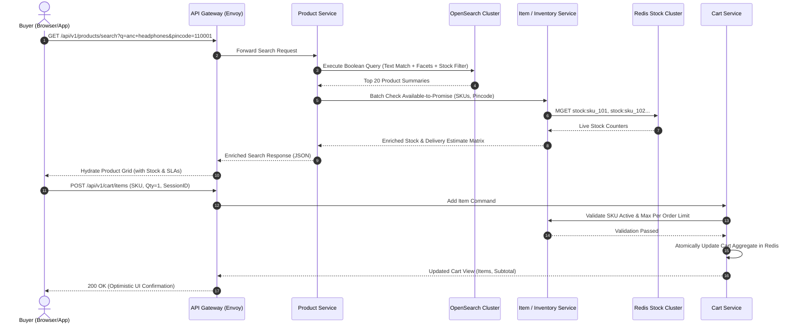
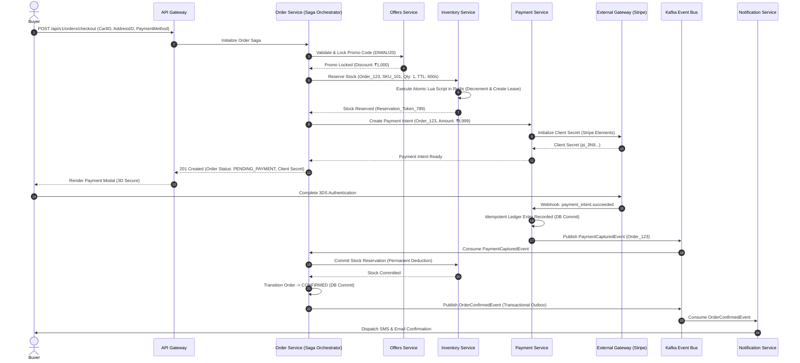
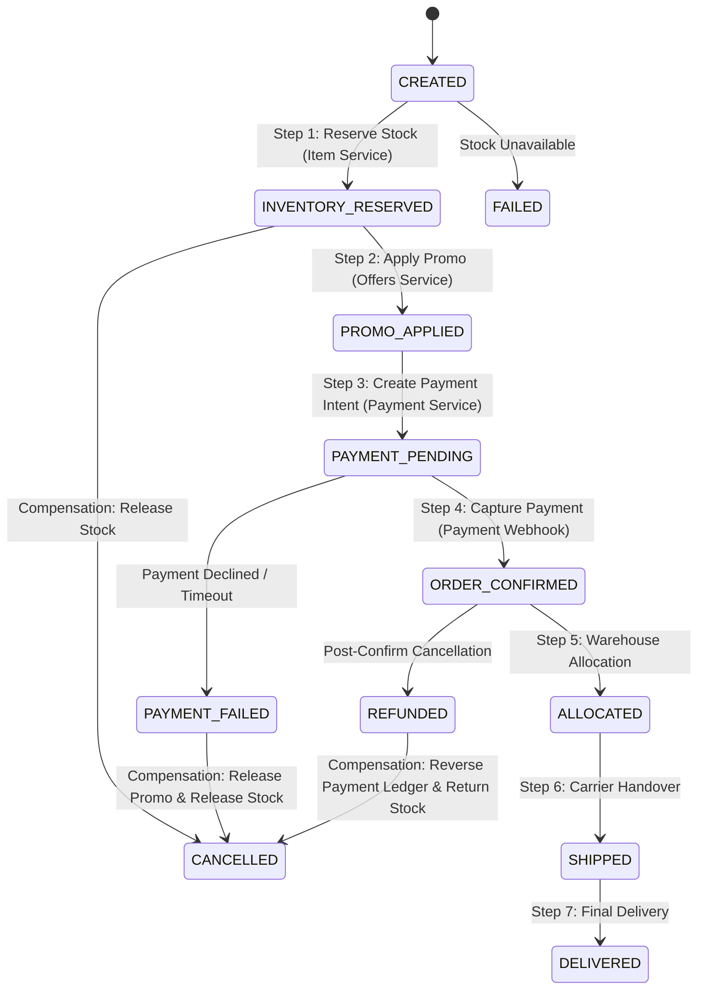
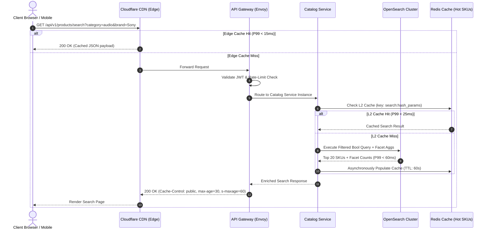
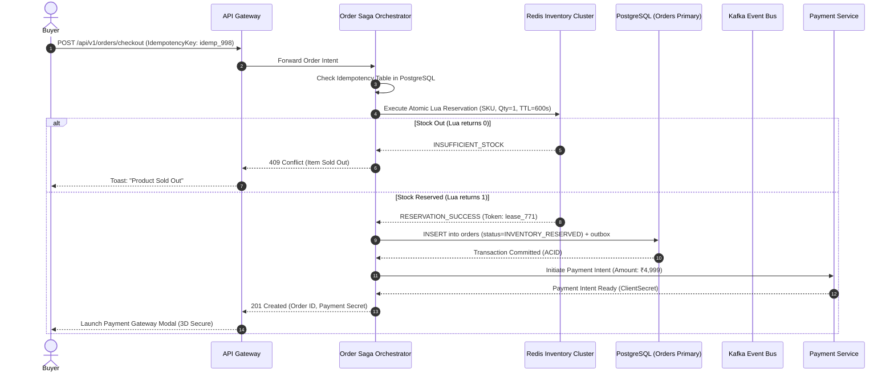
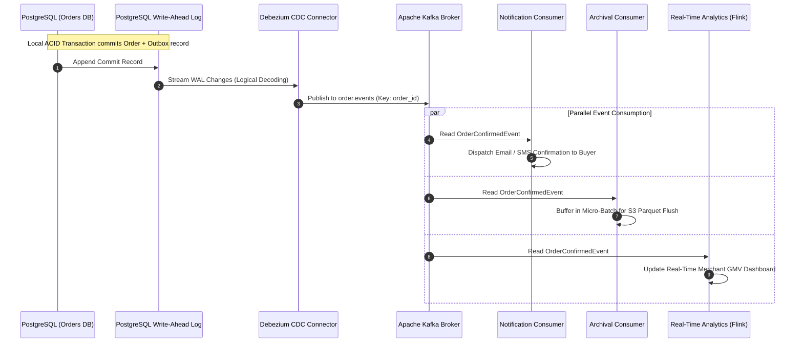
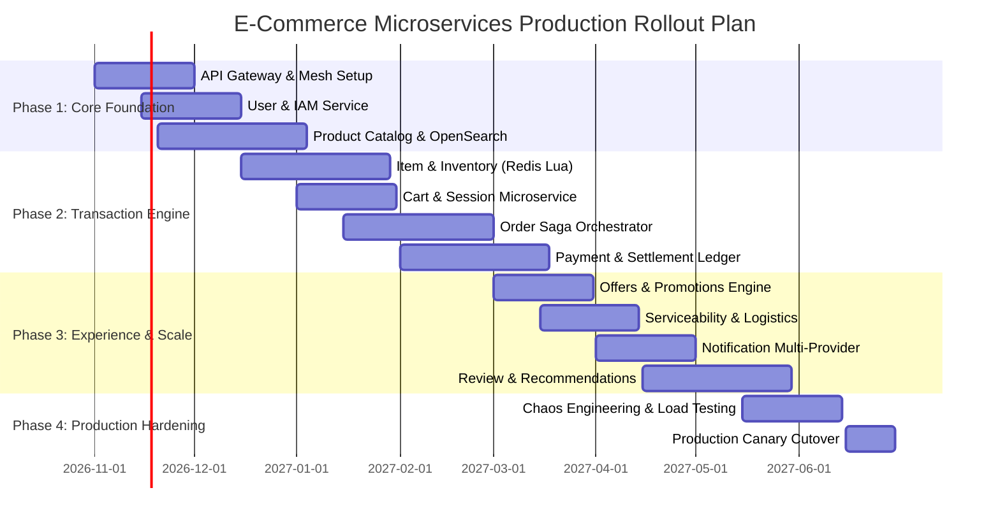

# E-Commerce Microservices Platform — Production System Architecture & Technical Specification

**Project:** Enterprise Cloud-Native E-Commerce Microservices Platform  
**Architecture Classification:** Distributed Event-Driven Microservices Architecture (CQRS + Saga Orchestration)  
**Tech Stack:** Java 21 / Kotlin 2.0 · Gradle (`build.gradle.kts`) · Spring Boot 3.3 / Micronaut · Spring Cloud Gateway / Envoy · Istio Service Mesh · Apache Kafka · PostgreSQL 16 · Redis 7 Cluster · OpenSearch 2.13 · HashiCorp Vault · Kubernetes (EKS/GKE)  
**Domain Modules (Bounded Contexts):** User & IAM, Product Catalog, Item Management & Inventory, Cart & Checkout Session, Order Processing, Payment & Settlement Ledger, Notification Engine, Offers & Promotions, Review & Ratings, Recommendations & Personalization, Serviceability & Logistics, Data Archival & Compliance  
**Document Version:** 2.0 (Production-Grade Enterprise Baseline)  
**Status:** Approved for Implementation  
**Ownership:** Principal Distributed Systems Architect & Lead Product Architect  

---

## LAYER 1: BUSINESS SPECIFICATION & VALUE REALIZATION

### 1.1 Executive Summary & Problem Statement

#### 1.1.1 Problem Statement
Legacy monolithic e-commerce platforms suffer from tight physical and logical coupling where changes to dynamic promotion or catalog schemas require risky, monolithic deployments. Peak flash-sale and seasonal traffic surges (e.g., 50x baseline) induce cascading failures across relational databases, causing lock contention in inventory and checkout tables that paralyzes the entire system. Vendor onboarding takes weeks due to monolithic schema migrations, while real-time personalization algorithms compete directly for CPU and database connection pools with mission-critical order-processing transactions.

#### 1.1.2 Market Gap
Mid-market and enterprise multi-vendor merchants require a platform that provides:
1. **Independent Elasticity:** Ability to scale read-heavy catalog searches (50,000+ QPS) independently from write-heavy transactional checkouts (1,000+ TPS).
2. **Deterministic Flash-Sale Performance:** Guaranteed atomic stock reservation without database deadlocks during high-contention traffic spikes.
3. **Decoupled Business Agility:** Zero-downtime releases allowing separate deployment cycles across 12 distinct functional domains.
4. **Resilient Eventual Consistency:** Fault-tolerant distributed transactions that eliminate double-charging, phantom stock reservations, and silent event loss.

#### 1.1.3 Business Objectives & Target Service Level Objectives (SLOs)
* **Scale Target:** Support 50,000,000 registered users, 5,000,000 Daily Active Users (DAU), and peak throughput of 1,000 completed checkout transactions per second (TPS) during flash-sale events.
* **Catalog Latency:** Sub-100ms P99 API response time for product catalog search and listing views.
* **Checkout Latency:** Sub-400ms P99 end-to-end response time for order placement and payment initiation.
* **High Availability:** 99.99% availability for critical path services (Order, Payment, Inventory, Gateway), equating to less than 4.38 minutes of unscheduled downtime per month.

---

### 1.2 Core Value Proposition Matrix

| Stakeholder | Pain Point in Legacy Architecture | Value Proposition in Target Platform | Key Enabling Microservices |
| :--- | :--- | :--- | :--- |
| **Buyer (Consumer)** | Stockouts discovered only at final payment step; slow page hydration; lost carts across device switches; payment failures with ambiguous states. | Sub-second faceted catalog search; real-time Available-to-Promise (ATP) stock visibility; persistent cross-device carts; transparent order tracking via SSE. | Product Catalog, Inventory, Cart, Order, Payment, Serviceability, Notification |
| **Merchant / Vendor** | Delayed inventory synchronization; manual price updates; inability to run targeted flash promos; opaque payout reconciliation. | Real-time multi-warehouse inventory feed; self-serve promotional campaign configuration; dynamic regional serviceability controls; transparent automated settlement ledgers. | Product, Inventory, Offers, Serviceability, Payment, Review & Ratings |
| **Platform Operator (SRE)** | Single point of failure; cascading service degradation; lack of distributed tracing; risky all-or-nothing deployments. | Zero-downtime canary deployments; circuit breaker isolation; automated horizontal pod autoscaling (HPA); unified OpenTelemetry distributed tracing and metrics. | API Gateway, Service Mesh, Config Server, Central IAM |
| **Platform Owner (Executive)** | Revenue leakages from uncollected commission fees; lack of unified merchant monetization; slow expansion to new geographies. | Automated multi-tiered take-rate deductions; merchant SaaS subscription tier enforcement; paid promotional placements; auditable compliance logs. | User & IAM, Offers, Payment, Recommendations, Archival |

---

### 1.3 Key Performance Indicators (KPIs) & Target SLAs

```
                               ┌───────────────────────────┐
                               │   PLATFORM HEALTH (99.99%)│
                               └─────────────┬─────────────┘
                                             │
             ┌───────────────────────────────┼───────────────────────────────┐
             ▼                               ▼                               ▼
┌─────────────────────────┐     ┌─────────────────────────┐     ┌─────────────────────────┐
│     CONVERSION FUNNEL   │     │    FULFILLMENT & SLA    │     │      FINANCIAL SLA      │
│ • Cart-to-Order: ≥ 70%  │     │ • Order-to-Ship: ≤ 4h   │     │ • Payment Success: ≥98% │
│ • Catalog P99: < 100ms  │     │ • Pincode Check: < 50ms │     │ • Reconciliation: 100%  │
│ • Search CTR: ≥ 18%     │     │ • Stock Drift: 0.00%    │     │ • Dispute Rate: < 0.1%  │
└─────────────────────────┘     └─────────────────────────┘     └─────────────────────────┘
```

| Domain Metric | Formal Definition | Target SLA / SLO | Measurement Boundary | Upstream / Downstream Services |
| :--- | :--- | :--- | :--- | :--- |
| **Cart-to-Order Conversion** | `(Completed Orders / Created Carts) * 100` | $\ge 70\%$ | Gateway to Order Confirmation | Cart $\rightarrow$ Inventory $\rightarrow$ Offers $\rightarrow$ Payment $\rightarrow$ Order |
| **Catalog Query P99 Latency** | Time elapsed for faceted search / detail queries | $\le 100\text{ ms}$ | API Gateway Entry to Client | API Gateway $\rightarrow$ Product Catalog $\rightarrow$ OpenSearch |
| **Checkout Flow P99 Latency** | Time to execute stock reservation and create payment intent | $\le 400\text{ ms}$ | POST `/checkout` to Client | Order $\rightarrow$ Inventory $\rightarrow$ Offers $\rightarrow$ Payment |
| **Serviceability SLA** | Roundtrip latency for pincode/hub delivery calculation | $\le 50\text{ ms}$ (P99) | Client request to Gateway | Serviceability $\rightarrow$ Logistics Geofence |
| **Payment Success Rate** | `(Authorized Payments / Attempted Payments) * 100` | $\ge 98.0\%$ | Payment Provider Webhook | Payment $\rightarrow$ External Gateway (Stripe/Adyen) |
| **Inventory Accuracy** | `1 - (Phantom Oversells / Total Orders)` | $100.00\%$ | Reservation Token Expiration | Inventory Service $\rightarrow$ Redis Atomic Tokens |
| **Offer Redemption Rate** | `(Redeemed Vouchers / Issued Vouchers) * 100` | $\ge 40\%$ | Cart Apply to Order Confirm | Offers Service $\rightarrow$ Cart |
| **Fulfillment Handover** | Time from order placement to warehouse dispatch | $\text{P95} \le 4.0\text{ hours}$ | Order Confirmed to Carrier Scan | Order $\rightarrow$ Item/Inventory $\rightarrow$ Logistics |

---

### 1.4 Monetization & Financial Flow Mechanics

1. **Transaction Commission (Take-Rate):**
   * Variable take-rate between $2.5\%$ and $8.0\%$ deducted automatically on every completed order based on merchant category.
   * Settled asynchronously via the Payment Service's double-entry ledger (`ledger_entries`) into escrow, disbursing net proceeds to vendors on a $T+2$ rolling basis.
2. **Merchant SaaS Subscription Tiers:**
   * **Starter ($49/month):** Up to 500 SKUs, standard catalog indexing, 5% commission.
   * **Growth ($199/month):** Up to 10,000 SKUs, priority search ranking, 3.5% commission, dedicated account manager.
   * **Enterprise ($799/month):** Unlimited SKUs, sub-minute inventory sync APIs, custom promo rules, 2.5% commission.
3. **Promotional Placement Fees (Sponsored Products):**
   * Cost-Per-Click (CPC) and Cost-Per-Impression (CPM) bidding engine managed by the Offers and Recommendations services, injecting sponsored catalog items into top search positions.
4. **Logistics & Delivery Convenience Margins:**
   * Dynamic delivery fee calculation by the Serviceability Service based on volumetric weight, distance band, and express fulfillment priority.

---

## LAYER 2: PRODUCT SENSE & USER EXPERIENCE SPECIFICATION

### 2.1 User Personas

```
┌────────────────────────────────────────────────────────────────────────────────────────────────────────┐
│                                       TARGET PLATFORM PERSONAS                                         │
├────────────────────────────┬────────────────────────────┬─────────────────────────────┬────────────────┤
│ 1. Buyer (Consumer)        │ 2. Merchant / Seller       │ 3. Customer Operations      │ 4. Platform SRE│
│ • Intent: Frictionless buy │ • Intent: Catalog & orders │ • Intent: Issue resolution  │ • Intent: SLA  │
│ • Primary: Mobile/Web      │ • Primary: Merchant Portal │ • Primary: Internal Admin   │ • Primary: K8s │
│ • Latency Sensitive: High  │ • Batch/CRUD Heavy: High   │ • Audit & Traceability: High│ • Zero Downtime│
└────────────────────────────┴────────────────────────────┴─────────────────────────────┴────────────────┘
```

#### Persona 1: Consumer Buyer (Aisha)
* **Demographics:** Urban professional, mobile-first shopper, high disposable income, zero tolerance for payment friction.
* **Goals:** Instant search with autocomplete, real-time stock certainty, single-click checkout, instant payment confirmation, live delivery tracking.
* **Frustrations:** Products appearing in stock that fail at checkout; ambiguous payment processing spinners; delayed SMS/email confirmations.
* **Services Interacted:** API Gateway, Product Catalog, Cart, Inventory, Offers, Payment, Order, Notification, Recommendations.

#### Persona 2: Multi-Warehouse Merchant (Rajesh)
* **Demographics:** Mid-sized electronic retailer operating across 3 regional fulfillment warehouses.
* **Goals:** Bulk SKU updates via API/CSV; real-time inventory synchronization from local ERP; dynamic promo code creation; automated bi-weekly payout settlements.
* **Frustrations:** Delayed inventory updates causing overselling; opaque return processing fees; inability to restrict promotions to specific pincodes.
* **Services Interacted:** Product Catalog, Item Management, Offers, Serviceability, Order, Review & Ratings, Archival.

#### Persona 3: Customer Operations Specialist (Elena)
* **Demographics:** Platform support lead handling tier-2 escalations and chargebacks.
* **Goals:** Unified single-screen timeline of order state transitions, payment gateway transaction IDs, stock reservation logs, and notification delivery receipts.
* **Frustrations:** Disjointed database logs across multiple services; inability to issue partial refunds or manual stock re-allocations without engineering tickets.
* **Services Interacted:** Order, Payment, Inventory, Notification, User & IAM, Archival.

#### Persona 4: Platform SRE (Vikram)
* **Demographics:** Distributed systems engineer maintaining infrastructure stability and resilience.
* **Goals:** Zero-downtime deployments via canary traffic shifting; immediate detection of circuit breaker trip events; strict tenant rate-limiting.
* **Services Interacted:** API Gateway, Istio Service Mesh, HashiCorp Vault, Kafka Cluster, Prometheus/Grafana.

---

### 2.2 End-to-End User Journeys

#### Journey 1: Search Discovery, Real-Time ATP Verification & Atomic Cart Addition



#### Journey 2: Distributed Checkout, Saga Stock Reservation & Payment Capture



---

### 2.3 Comprehensive Functional Requirements (PRD Specification)

| Requirement ID | Module / Domain | Priority | Description | Acceptance Criteria |
| :--- | :--- | :--- | :--- | :--- |
| **FR-CAT-01** | Product Catalog | P0 | Full-text and faceted search with semantic understanding and spell check. | Query latency $\le 80\text{ ms}$ for 95% of queries over 10M SKUs; fuzzy matching handles 2-character typos. |
| **FR-INV-01** | Item / Inventory | P0 | Real-time Available-to-Promise (ATP) tracking per SKU and regional warehouse. | Stock reservations expire deterministically after 10 minutes if uncommitted; zero phantom overselling under 10k QPS. |
| **FR-CRT-01** | Cart Service | P0 | Distributed cart session supporting guest users and authenticated merge. | Guest cart automatically merged with user cart on login without dropping items; Redis persistence with 30-day TTL. |
| **FR-ORD-01** | Order Processing | P0 | Orchestrated Saga execution for multi-step order lifecycle state transitions. | State machine persists transitions in PostgreSQL with optimistic locking; automatic compensation rollback on failure. |
| **FR-PAY-01** | Payment Service | P0 | PCI DSS SAQ-A compliant multi-provider payment processing with double-entry ledger. | Zero plain-text card storage; idempotent webhook processing; double-entry ledger verification prevents imbalanced settlements. |
| **FR-OFF-01** | Offers Service | P1 | Dynamic rule-based discount evaluation with global usage ceilings. | Support cart-level, SKU-level, and tier-based discounts; atomic usage counters prevent coupon over-redemption. |
| **FR-SRV-01** | Serviceability | P1 | Real-time delivery availability, shipping charges, and SLA calculation per pincode. | Evaluates vendor warehouse proximity, carrier constraints (weight/hazmat), and cutoff times in $\le 50\text{ ms}$. |
| **FR-REV-01** | Review & Ratings | P1 | Verified-buyer review submissions with abuse filtering and Bayesian scoring. | Submissions restricted to users with `DELIVERED` status for that SKU; asynchronous score aggregation to Product Catalog. |
| **FR-REC-01** | Recommendations | P2 | Personalized item recommendations ("Frequently Bought Together", "Trending"). | Ingests clickstream and purchase events from Kafka; serves inference rankings in $\le 60\text{ ms}$ with heuristic fallback. |
| **FR-NOT-01** | Notification | P1 | Multi-channel delivery (Email, SMS, WhatsApp, WebPush) with priority queuing. | P0 notifications (OTP, Order Placed) delivered to vendor provider within 3 seconds of event ingestion. |
| **FR-ARC-01** | Data Archival | P2 | Automated cold-storage partitioning for orders and audits older than 90 days. | Regulatory 7-year audit retention compliance; support on-demand historical queries via Trino/Athena; GDPR data erasure. |
| **FR-USR-01** | User & IAM | P0 | Role-based identity management, OAuth2/OIDC token issuance, and address book. | Token validation via JWKS in sub-5ms at API Gateway; MFA enforcement for merchant and administrative accounts. |

---

### 2.4 Distributed Failure Modes & Edge Case Matrix

| Scenario / Failure Mode | Affected Microservices | Root Cause Trigger | System Mitigation & Recovery Strategy | Client / UX Manifestation |
| :--- | :--- | :--- | :--- | :--- |
| **Flash Sale Stock Exhaustion** | Cart $\rightarrow$ Inventory $\rightarrow$ Order | 50,000 users attempting to buy 1,000 units simultaneously. | Redis Lua script executes atomic test-and-decrement. When counter hits 0, subsequent requests are rejected at cache tier without hitting RDBMS. | Client displays "Sold Out" badge; button disabled; user invited to join "Waitlist" via Notification Service. |
| **Payment Success but Order Timeout** | Payment $\rightarrow$ Order Service | Network partition between Payment Webhook and Order Service after card authorization. | Idempotent webhook receiver writes to Payment DB and publishes to Kafka. Order Service reconciles missing state via polling consumer or CDC replay. | Buyer sees "Payment Received — Securing Your Order" screen with auto-polling SSE stream; no duplicate charge. |
| **Payment 3DS Abandonment** | Payment $\rightarrow$ Inventory $\rightarrow$ Order | Buyer closes browser during banking OTP / 3DS authentication. | Redis reservation token expires at 600s TTL. Scheduled Reaper job or Redis key-expiration hook returns units to ATP pool. Order marked `ABANDONED`. | Cart retains items with notification: "Stock reservation expired. Click checkout to re-verify availability." |
| **Serviceability Timeout** | API Gateway $\rightarrow$ Serviceability | Logistics database latency spike exceeds 100ms threshold. | Resilience4j circuit breaker trips to OPEN. Gateway executes fallback to regional pincode cache (stale-while-revalidate). | Client displays: "Estimated Delivery: 3-5 Days (Live verification pending)." |
| **Double Webhook Delivery** | Payment Gateway $\rightarrow$ Payment | External payment gateway (Stripe/Adyen) delivers duplicate webhooks due to slow ACK. | Unique constraint on `payment_transactions.provider_reference`. Subsequent webhook hits idempotent deduplication check and returns `200 OK` immediately. | Silent backend deduplication; user experiences zero impact or double-allocation. |
| **Notification Provider Outage** | Order $\rightarrow$ Notification Engine | Third-party SMS/Email gateway experiences 5xx failure. | Notification Service queues event in dead-letter retry topic with exponential jitter; falls back to secondary SMS carrier (e.g., Twilio $\rightarrow$ AWS SNS). | In-app notification center displays order confirmation immediately; SMS arrives with slight delay. |

---

## LAYER 3: PRODUCTION FRONTEND & CLIENT ARCHITECTURE

### 3.1 RADIO Framework Implementation for E-Commerce

```
┌────────────────────────────────────────────────────────────────────────────────────────┐
│                              RADIO FRAMEWORK ARCHITECTURE                              │
├─────────────────────┬─────────────────────┬────────────────────┬───────────────────────┤
│ R - Requirements    │ A - Architecture    │ D - Data Models    │ I - Interfaces / APIs │
│ • Core Web Vitals   │ • Next.js 14+ SSR   │ • Normalised Store │ • Typed REST / JSON   │
│ • SEO Maximisation  │ • Module Federation │ • Optimistic Carts │ • SSE Order Stream    │
│ • WCAG 2.1 AAA      │ • Edge Cloudflare   │ • Offline Queues   │ • GraphQL BFF Aggreg  │
└─────────────────────┴─────────────────────┴────────────────────┴───────────────────────┘
```

#### R — Requirements & Constraints
* **Performance Budget:** First Contentful Paint (FCP) $\le 1.2\text{s}$, Largest Contentful Paint (LCP) $\le 2.0\text{s}$, Cumulative Layout Shift (CLS) $\le 0.05$, Interaction to Next Paint (INP) $\le 150\text{ms}$.
* **Device Spectrum:** Responsive web (Mobile/Tablet/Desktop) + Native iOS/Android apps sharing core API contracts.
* **SEO Constraints:** 100% server-renderable HTML for all public catalog, brand, and category pages with dynamic OpenGraph meta tags and Schema.org microdata.

#### A — Architecture & Hybrid Rendering Strategy
* **Catalog & Landing Pages:** Server-Side Rendering (SSR) with Incremental Static Regeneration (ISR) using Next.js 14+ App Router. Catalog pages revalidate every 60 seconds.
* **Cart, Checkout & User Dashboard:** Client-Side Rendering (CSR) protected by authenticated sessions and edge-routed to nearest Cloudflare Points of Presence (PoP).
* **Micro-Frontend Modularization:** Core domains partitioned via Webpack Module Federation:
  * `catalog-mfe`: Search bar, filter facets, product display cards.
  * `checkout-mfe`: Cart drawer, promo code applicator, address selector, payment container.
  * `account-mfe`: Order history, tracking timeline, reviews, returns management.

#### D — Client State Architecture & Normalized Data Stores
* Local client cache partitioned into:
  1. **Server State (TanStack Query):** Product queries, search results, stock status, cached with strict TTLs and stale-while-revalidate policies.
  2. **Session / Client State (Zustand):** Local cart modifications, drawer toggles, active filter selections.
  3. **Offline Queue (IndexedDB):** Queued offline mutations (e.g., wishlist additions, unsent analytics events).

#### I — Interface Protocols & Aggregation
* **Primary Interconnect:** RESTful HTTPS JSON APIs mediated by Spring Cloud Gateway / Envoy.
* **Complex Page Aggregation:** Backend-for-Frontend (BFF) aggregation layer combining Product Details, Live Stock, Reviews, and Related Items into a single payload.
* **Live Streams:** Server-Sent Events (SSE) on `/api/v1/orders/{orderId}/timeline` for real-time order status tracking.

#### O — Edge & Client Optimizations
* **Image Transformation Pipeline:** Dynamic WebP/AVIF generation with `srcset` served from edge CDN with 30-day immutability headers.
* **Resource Prioritization:** Critical CSS inlined; non-critical script bundles deferred; DNS prefetch and preconnect for CDN and Payment Gateway origins.

---

### 3.2 6-State Component Design Contract

Every user-facing component adheres to a deterministic 6-state finite state machine in TypeScript:

```typescript
export type AsyncState<TData, TError = ApiError> =
  | { status: 'IDLE'; data: null; error: null }
  | { status: 'LOADING'; data: TData | null; error: null }
  | { status: 'SUCCESS'; data: TData; error: null }
  | { status: 'ERROR'; data: TData | null; error: TError }
  | { status: 'OPTIMISTIC'; data: TData; error: null; pendingMutationId: string }
  | { status: 'OFFLINE_QUEUED'; data: TData | null; error: null; queueReference: string };

export interface ApiError {
  code: string;
  message: string;
  fieldErrors?: Record<string, string>;
  requestId: string;
  timestamp: string;
}
```

#### Deterministic State Transition Matrix for Cart Modification

| Trigger / User Action | Current State | Target State | UI Behavior & DOM Updates | Network & Storage Action |
| :--- | :--- | :--- | :--- | :--- |
| Initial Page Load | `IDLE` | `LOADING` | Skeleton loader rendered in cart sidebar. | Fetch `GET /api/v1/cart` via TanStack Query. |
| Fetch Successful | `LOADING` | `SUCCESS` | Cart items, prices, and checkout button activated. | Hydrate in-memory Zustand store and localStorage. |
| Network Disconnected | `SUCCESS` | `OFFLINE_QUEUED` | Offline indicator shown; optimistic item update retained. | Mutation stored in IndexedDB offline write-queue. |
| User Clicks "Add Item" | `SUCCESS` | `OPTIMISTIC` | Badge counter increments immediately; subtotal updates. | Dispatches `POST /api/v1/cart/items` with rollback snapshot. |
| Server Returns 200 OK | `OPTIMISTIC` | `SUCCESS` | Subtle checkmark animation; pending mutation cleared. | Overwrite local state with authoritative server cart payload. |
| Server Returns 409 Conflict | `OPTIMISTIC` | `ERROR` | Revert badge counter; toast: "Insufficient stock for SKU". | Rollback to pre-mutation snapshot; invalidate query cache. |

---

### 3.3 Production Frontend Technical Requirements Matrix

```
┌────────────────────────────────────────────────────────────────────────────────────────┐
│                              FRONTEND TECHNICAL CAPABILITIES                           │
├────────────────────────────┬─────────────────────────────┬─────────────────────────────┤
│ Performance & Rendering    │ Security & Resiliency       │ Accessibility & Inclusivity │
│ • Next.js App Router (SSR) │ • CSP Level 3 Strict        │ • WCAG 2.1 AAA Compliant    │
│ • WebP / AVIF Responsive   │ • Anti-CSRF Double-Submit   │ • ARIA Live Regions         │
│ • Brotli Compression       │ • Subresource Integrity SRI │ • Full Keyboard Navigability│
│ • Suspense Streaming       │ • Error Boundary Sandboxing │ • Screen Reader Friendly    │
└────────────────────────────┴─────────────────────────────┴─────────────────────────────┘
```

* **Core Web Vitals Enforcement:** Synthetic Lighthouse CI integrated into GitHub Actions rejecting PRs with performance scores $< 90$.
* **Accessibility (a11y):** Full semantic HTML5; ARIA live regions for cart updates (`aria-live="polite"`); focus trapping within modals; color contrast ratio $\ge 7:1$.
* **Progressive Web App (PWA):** Workbox Service Worker caching static shells; background sync for offline analytics; Web App Manifest enabling standalone mobile installation.
* **Security Measures:** Strict Content Security Policy (`default-src 'self'`); anti-CSRF tokens embedded in mutating requests; XSS sanitization via DOMPurify.

---

## LAYER 4: MACHINE CODING & LOW-LEVEL COMPONENT DESIGN

### 4.1 Core Distributed Design Patterns

#### 4.1.1 Orchestrated Saga Pattern — Order Fulfillment State Machine
Choreographed sagas become unmaintainable as domain complexity grows. This platform uses an **Orchestrated Saga Pattern** where the `Order Service` serves as the central stateful orchestrator.



* **Compensation Logic Guarantee:** Every forward step has an idempotent compensating action:
  * `ReserveStock` $\rightarrow$ `Compensate: ReleaseStockReservation`
  * `ApplyPromo` $\rightarrow$ `Compensate: UnlockPromoCode`
  * `AuthorizePayment` $\rightarrow$ `Compensate: VoidPaymentAuthorization / IssueRefund`

#### 4.1.2 Transactional Outbox Pattern with Debezium CDC
To prevent distributed dual-write inconsistencies between PostgreSQL and Apache Kafka:
1. Every domain service writes its domain entity state change and an outbox event record within the **same local ACID database transaction**.
2. Debezium Change Data Capture (CDC) monitors the PostgreSQL Write-Ahead Log (WAL) and publishes events to Kafka with zero application-level dual-write vulnerability.

```sql
-- Outbox Table Schema in PostgreSQL (Partitioned by Month)
CREATE TABLE transactional_outbox (
    event_id UUID PRIMARY KEY DEFAULT gen_random_uuid(),
    aggregate_type VARCHAR(64) NOT NULL,
    aggregate_id VARCHAR(64) NOT NULL,
    event_type VARCHAR(64) NOT NULL,
    payload JSONB NOT NULL,
    trace_context JSONB NOT NULL,
    created_at TIMESTAMPTZ NOT NULL DEFAULT CURRENT_TIMESTAMP,
    processed_at TIMESTAMPTZ NULL
) PARTITION BY RANGE (created_at);
```

#### 4.1.3 High-Concurrency Atomic Flash-Sale Stock Engine
To achieve sub-5ms stock reservations under extreme concurrency without relational row deadlocks, stock counters are decremented atomically using a Redis Lua script:

```lua
-- Atomic Stock Reservation Lua Script (Executed on Redis Shard)
-- KEYS[1]: stock:counter:{sku_id}
-- KEYS[2]: stock:leases:{order_id}
-- ARGV[1]: requested_quantity
-- ARGV[2]: order_id
-- ARGV[3]: lease_ttl_seconds

local current_stock = redis.call('GET', KEYS[1])
if not current_stock then
    return -1 -- SKU not found
end

local available = tonumber(current_stock)
local required = tonumber(ARGV[1])

if available >= required then
    -- Atomically decrement stock counter
    redis.call('DECRBY', KEYS[1], required)
    -- Record reservation lease with TTL
    redis.call('HSET', KEYS[2], 'sku', KEYS[1], 'qty', required, 'reserved_at', redis.call('TIME')[1])
    redis.call('EXPIRE', KEYS[2], tonumber(ARGV[3]))
    return 1 -- Reservation Successful
else
    return 0 -- Insufficient Stock
end
```

---

### 4.2 Protobuf & Inter-Service gRPC Contracts

For latency-critical communication between the Order Service and Inventory Service, binary gRPC over HTTP/2 is utilized in place of REST:

```protobuf
syntax = "proto3";

package com.platform.inventory.v1;

option java_multiple_files = true;
option java_package = "com.platform.inventory.v1";

service InventoryService {
  rpc ReserveStock (ReserveStockRequest) returns (ReserveStockResponse);
  rpc CommitReservation (CommitReservationRequest) returns (CommitReservationResponse);
  rpc ReleaseReservation (ReleaseReservationRequest) returns (ReleaseReservationResponse);
  rpc CheckAvailability (CheckAvailabilityRequest) returns (CheckAvailabilityResponse);
}

message StockItemRequest {
  string sku = 1;
  int32 quantity = 2;
  string warehouse_id = 3;
}

message ReserveStockRequest {
  string order_id = 1;
  string customer_id = 2;
  repeated StockItemRequest items = 3;
  int32 reservation_ttl_seconds = 4;
  string idempotency_key = 5;
}

message ReserveStockResponse {
  enum ReservationStatus {
    RESERVATION_STATUS_UNSPECIFIED = 0;
    SUCCESS = 1;
    INSUFFICIENT_STOCK = 2;
    SKU_NOT_FOUND = 3;
    DUPLICATE_IDEMPOTENT_REQUEST = 4;
  }
  ReservationStatus status = 1;
  string reservation_id = 2;
  int64 expires_at_epoch_ms = 3;
  string error_message = 4;
}

message CommitReservationRequest {
  string reservation_id = 1;
  string order_id = 2;
}

message CommitReservationResponse {
  bool committed = 1;
  int64 committed_at_epoch_ms = 2;
}

message ReleaseReservationRequest {
  string reservation_id = 1;
  string order_id = 2;
  string cancellation_reason = 3;
}

message ReleaseReservationResponse {
  bool released = 1;
  int32 restored_quantity = 2;
}

message CheckAvailabilityRequest {
  repeated string skus = 1;
  string destination_pincode = 2;
}

message StockAvailability {
  string sku = 1;
  int32 available_to_promise = 2;
  bool is_serviceable = 3;
  int32 estimated_delivery_days = 4;
}

message CheckAvailabilityResponse {
  repeated StockAvailability items = 1;
}
```

---

### 4.3 Kafka CloudEvents Specification

All asynchronous events adhere to the CNCF CloudEvents standard formatted in JSON:

#### `OrderConfirmedEvent` Specification (`order.events` topic)

```json
{
  "specversion": "1.0",
  "type": "com.platform.order.confirmed.v1",
  "source": "/services/order-service/cluster-prod-01",
  "id": "evt_9c8b7a6d-4e3f-4a1b-8c2d-1e0f9a8b7c6d",
  "time": "2026-11-01T08:30:00Z",
  "datacontenttype": "application/json",
  "dataschema": "https://schema.platform.com/events/order-confirmed-v1.json",
  "data": {
    "orderId": "ord_8829104",
    "customerId": "cust_440192",
    "orderStatus": "CONFIRMED",
    "currency": "INR",
    "financialSummary": {
      "subtotal": 12999.00,
      "discountAmount": 1000.00,
      "shippingFee": 0.00,
      "taxAmount": 2159.82,
      "grandTotal": 14158.82
    },
    "paymentDetails": {
      "paymentTransactionId": "txn_pay_7721049",
      "paymentMethod": "UPI",
      "gatewayProvider": "RAZORPAY"
    },
    "lineItems": [
      {
        "sku": "SKU-HEADPHONE-PRO-BLK",
        "quantity": 1,
        "unitPrice": 12999.00,
        "vendorId": "vnd_tech_direct",
        "warehouseId": "wh_delhi_hub_01"
      }
    ],
    "shippingAddress": {
      "addressId": "addr_991823",
      "pincode": "110001",
      "city": "New Delhi",
      "state": "Delhi",
      "country": "IN"
    }
  }
}
```

---

### 4.4 Production Kotlin Domain Entities

#### Order Domain Aggregate Root (Kotlin + Spring Data JPA)

```kotlin
package com.platform.order.domain

import jakarta.persistence.*
import org.hibernate.annotations.JdbcTypeCode
import org.hibernate.type.SqlTypes
import java.math.BigDecimal
import java.time.Instant
import java.util.UUID

enum class OrderStatus {
    CREATED,
    INVENTORY_RESERVED,
    PAYMENT_PENDING,
    CONFIRMED,
    ALLOCATED,
    SHIPPED,
    DELIVERED,
    CANCELLED,
    REFUNDED
}

@Entity
@Table(
    name = "orders",
    indexes = [
        Index(name = "idx_orders_customer", columnList = "customer_id"),
        Index(name = "idx_orders_status", columnList = "order_status"),
        Index(name = "idx_orders_created_at", columnList = "created_at")
    ]
)
class Order(
    @Id
    @Column(name = "order_id", length = 64, nullable = false, updatable = false)
    val id: String = "ord_${UUID.randomUUID()}",

    @Column(name = "customer_id", length = 64, nullable = false)
    val customerId: String,

    @Enumerated(EnumType.STRING)
    @Column(name = "order_status", length = 32, nullable = false)
    var status: OrderStatus = OrderStatus.CREATED,

    @OneToMany(cascade = [CascadeType.ALL], orphanRemoval = true, fetch = FetchType.EAGER)
    @JoinColumn(name = "order_id", nullable = false)
    val lineItems: MutableList<OrderLineItem> = mutableListOf(),

    @Embedded
    var financialSummary: OrderFinancialSummary,

    @Column(name = "reservation_id", length = 64)
    var reservationId: String? = null,

    @Column(name = "payment_intent_id", length = 64)
    var paymentIntentId: String? = null,

    @JdbcTypeCode(SqlTypes.JSON)
    @Column(name = "shipping_snapshot", columnDefinition = "jsonb", nullable = false)
    val shippingSnapshot: ShippingAddressSnapshot,

    @Version
    @Column(name = "aggregate_version", nullable = false)
    var version: Long = 0,

    @Column(name = "created_at", nullable = false, updatable = false)
    val createdAt: Instant = Instant.now(),

    @Column(name = "updated_at", nullable = false)
    var updatedAt: Instant = Instant.now()
) {
    fun confirmPayment(transactionId: String) {
        check(this.status == OrderStatus.PAYMENT_PENDING || this.status == OrderStatus.INVENTORY_RESERVED) {
            "Cannot transition order $id to CONFIRMED from state ${this.status}"
        }
        this.paymentIntentId = transactionId
        this.status = OrderStatus.CONFIRMED
        this.updatedAt = Instant.now()
    }

    fun markCancelled(reason: String) {
        check(this.status != OrderStatus.DELIVERED && this.status != OrderStatus.SHIPPED) {
            "Cannot cancel order $id when already in state ${this.status}"
        }
        this.status = OrderStatus.CANCELLED
        this.updatedAt = Instant.now()
    }
}

@Entity
@Table(name = "order_line_items")
class OrderLineItem(
    @Id
    @GeneratedValue(strategy = GenerationType.IDENTITY)
    val id: Long = 0,

    @Column(name = "sku", length = 64, nullable = false)
    val sku: String,

    @Column(name = "product_name", length = 255, nullable = false)
    val productName: String,

    @Column(name = "quantity", nullable = false)
    val quantity: Int,

    @Column(name = "unit_price", precision = 12, scale = 2, nullable = false)
    val unitPrice: BigDecimal,

    @Column(name = "total_price", precision = 12, scale = 2, nullable = false)
    val totalPrice: BigDecimal,

    @Column(name = "vendor_id", length = 64, nullable = false)
    val vendorId: String
)

@Embeddable
data class OrderFinancialSummary(
    @Column(name = "subtotal_amount", precision = 12, scale = 2, nullable = false)
    val subtotal: BigDecimal,

    @Column(name = "discount_amount", precision = 12, scale = 2, nullable = false)
    val discount: BigDecimal,

    @Column(name = "tax_amount", precision = 12, scale = 2, nullable = false)
    val tax: BigDecimal,

    @Column(name = "shipping_fee", precision = 12, scale = 2, nullable = false)
    val shippingFee: BigDecimal,

    @Column(name = "grand_total", precision = 12, scale = 2, nullable = false)
    val grandTotal: BigDecimal,

    @Column(name = "currency", length = 3, nullable = false)
    val currency: String = "INR"
)

data class ShippingAddressSnapshot(
    val recipientName: String,
    val street: String,
    val city: String,
    val state: String,
    val pincode: String,
    val phone: String
)
```

---

### 4.5 Production Logic Algorithms

#### 4.5.1 Offers Engine: Multi-Factor Promo Validation & Atomic Reservation
This algorithm validates coupon applicability against cart contents, user tier caps, category exclusions, and enforces distributed usage limits:

```
FUNCTION evaluateAndLockPromo(userId, userTier, cartAggregate, promoCode):
    // Step 1: Fetch promo definition from Read-Through Cache
    promo = OffersCache.get("promo:def:" + promoCode)
    IF promo IS NULL:
        promo = OffersDatabase.findByCode(promoCode)
        IF promo IS NULL:
            RETURN Error(CODE="PROMO_NOT_FOUND", MSG="Invalid promo code")
        OffersCache.set("promo:def:" + promoCode, promo, TTL=300s)

    // Step 2: Validate temporal window
    currentTime = System.currentTimeUtc()
    IF currentTime < promo.validFrom OR currentTime > promo.validUntil:
        RETURN Error(CODE="PROMO_EXPIRED", MSG="Offer has expired")

    // Step 3: Check global & user redemption ceiling atomically in Redis
    userUsageKey = "promo:user:" + promoCode + ":" + userId
    globalUsageKey = "promo:global:" + promoCode

    // Atomic evaluation script via Redis
    redisLockResult = Redis.executeScript("""
        local globalCount = redis.call('GET', KEYS[1]) or 0
        local userCount = redis.call('GET', KEYS[2]) or 0
        if tonumber(globalCount) >= tonumber(ARGV[1]) then
            return -1 -- Global limit exceeded
        end
        if tonumber(userCount) >= tonumber(ARGV[2]) then
            return -2 -- User limit exceeded
        end
        redis.call('INCR', KEYS[1])
        redis.call('INCR', KEYS[2])
        return 1
    """, keys=[globalUsageKey, userUsageKey], args=[promo.maxGlobalRedemptions, promo.maxPerUserRedemptions])

    IF redisLockResult == -1:
        RETURN Error(CODE="PROMO_EXHAUSTED", MSG="Global redemption limit reached")
    IF redisLockResult == -2:
        RETURN Error(CODE="USER_LIMIT_EXCEEDED", MSG="You have already redeemed this promo")

    // Step 4: Validate cart minimum order value (MOV)
    IF cartAggregate.subtotal < promo.minimumOrderValue:
        // Compensate: release the incremented redis counters
        Redis.decr(globalUsageKey)
        Redis.decr(userUsageKey)
        RETURN Error(CODE="MOV_NOT_MET", MSG="Minimum order value of ₹" + promo.minimumOrderValue + " required")

    // Step 5: Filter applicable category items
    applicableSubtotal = 0
    FOR item IN cartAggregate.items:
        IF promo.restrictedCategories IS EMPTY OR promo.restrictedCategories.contains(item.categoryId):
            applicableSubtotal = applicableSubtotal + item.totalPrice

    IF applicableSubtotal == 0:
        Redis.decr(globalUsageKey)
        Redis.decr(userUsageKey)
        RETURN Error(CODE="CATEGORY_MISMATCH", MSG="No eligible items in cart for this offer")

    // Step 6: Compute base discount
    baseDiscount = 0
    IF promo.discountType == "PERCENTAGE":
        baseDiscount = applicableSubtotal * (promo.discountValue / 100.0)
        IF promo.maxDiscountCap IS NOT NULL:
            baseDiscount = MIN(baseDiscount, promo.maxDiscountCap)
    ELSE IF promo.discountType == "FIXED_AMOUNT":
        baseDiscount = MIN(promo.discountValue, applicableSubtotal)

    // Step 7: Apply User Loyalty Tier Multiplier
    tierMultiplier = 1.00
    SWITCH userTier:
        CASE "ENTERPRISE": tierMultiplier = 1.25
        CASE "GROWTH":     tierMultiplier = 1.15
        CASE "STARTER":    tierMultiplier = 1.05
        DEFAULT:           tierMultiplier = 1.00
    
    finalDiscount = ROUND(baseDiscount * tierMultiplier, 2)
    IF promo.maxDiscountCap IS NOT NULL:
        finalDiscount = MIN(finalDiscount, promo.maxDiscountCap)

    RETURN Success(
        promoId = promo.id,
        code = promoCode,
        discountApplied = finalDiscount,
        reservationLockId = UUID.randomUUID()
    )
```

#### 4.5.2 Serviceability Engine: Geo-Proximity & Carrier Routing SLA
Evaluates whether a multi-warehouse shipment can be fulfilled to a target destination pincode within SLA:

```
FUNCTION evaluateServiceability(destinationPincode, cartItems, requestedPriority):
    // Step 1: Validate destination postal format
    IF NOT destinationPincode.matches("^[1-9][0-9]{5}$"):
        RETURN ServiceabilityResult(isServiceable=false, reason="INVALID_PINCODE_FORMAT")

    // Step 2: Fetch destination geographical hub metadata
    destHub = ServiceabilityCache.getHubByPincode(destinationPincode)
    IF destHub IS NULL OR destHub.isActive == false:
        RETURN ServiceabilityResult(isServiceable=false, reason="NON_SERVICEABLE_ZONE")

    warehouseShipmentPlans = []
    overallServiceable = true

    // Step 3: Iterate each SKU and resolve nearest vendor warehouse holding stock
    FOR item IN cartItems:
        candidateWarehouses = InventoryService.findWarehousesWithStock(item.sku, item.quantity)
        IF candidateWarehouses IS EMPTY:
            RETURN ServiceabilityResult(isServiceable=false, reason="SKU_OUT_OF_STOCK_GLOBALLY", sku=item.sku)

        // Select warehouse with lowest geodesic / road distance
        selectedWarehouse = NULL
        minDistanceKm = INFINITY
        FOR wh IN candidateWarehouses:
            distance = calculateHaversineDistance(wh.latitude, wh.longitude, destHub.latitude, destHub.longitude)
            IF distance < minDistanceKm:
                minDistanceKm = distance
                selectedWarehouse = wh

        // Step 4: Check courier operational capability (e.g. Hazardous, Cold-Chain, Heavy)
        carrierRoute = RoutingMatrix.findOptimalCarrier(
            originHubId = selectedWarehouse.hubId,
            destHubId = destHub.hubId,
            weightGrams = item.weightGrams,
            isHazardous = item.isHazardous
        )

        IF carrierRoute IS NULL:
            overallServiceable = false
            BREAK

        // Step 5: Compute SLA considering warehouse daily cutoff time
        currentTime = System.currentTimeUtc()
        dispatchDayOffset = 0
        IF currentTime.toLocalTime() > selectedWarehouse.dailyCutoffTime:
            dispatchDayOffset = 1 // Orders past 4 PM dispatch next morning

        calculatedDeliveryDate = currentTime.plusDays(dispatchDayOffset + carrierRoute.transitDays)

        warehouseShipmentPlans.add(ShipmentPlan(
            sku = item.sku,
            originWarehouseId = selectedWarehouse.id,
            carrierId = carrierRoute.carrierId,
            transitDays = carrierRoute.transitDays,
            estimatedDelivery = calculatedDeliveryDate,
            shippingFee = carrierRoute.baseCost + (item.weightGrams / 1000.0 * carrierRoute.ratePerKg)
        ))

    IF NOT overallServiceable:
        RETURN ServiceabilityResult(isServiceable=false, reason="NO_CARRIER_SERVICE_FOR_WEIGHT_OR_ZONE")

    // Aggregate overall metrics (latest delivery date determines overall SLA)
    maxDeliveryDate = warehouseShipmentPlans.map(p -> p.estimatedDelivery).max()
    totalShippingFee = warehouseShipmentPlans.map(p -> p.shippingFee).sum()

    RETURN ServiceabilityResult(
        isServiceable = true,
        destinationPincode = destinationPincode,
        latestEstimatedDelivery = maxDeliveryDate,
        totalShippingFee = ROUND(totalShippingFee, 2),
        splitShipmentRequired = (warehouseShipmentPlans.map(p -> p.originWarehouseId).distinct().size() > 1),
        shipmentPlans = warehouseShipmentPlans
    )
```

---

## LAYER 5: BACKEND & DISTRIBUTED SYSTEMS ARCHITECTURE (GROKKING SYSTEM DESIGN BLUEPRINT)

This layer adapts the structured architectural framework popularized by the *Grokking the System Design Interview* curriculum (specifically the *Designing Dropbox / Distributed Cloud Storage* methodology), applying it rigorously to high-scale, event-driven e-commerce microservices. It covers back-of-the-envelope capacity estimations, component-level breakdowns, database partitioning and sharding, end-to-end data flows, concurrency control, caching tiers, load balancing, fault tolerance, and security.

---

### 5.1 High-Level Architecture & Component Blueprint

```
┌─────────────────────────────────────────────────────────────────────────────────────────────────┐
│                                CLIENT TIER (Web, iOS, Android App)                              │
└────────────────────────────────────────────────┬────────────────────────────────────────────────┘
                                                 │ Anycast DNS / HTTPS (TLS 1.3)
                                                 ▼
┌─────────────────────────────────────────────────────────────────────────────────────────────────┐
│                        GLOBAL LOAD BALANCER & CDN (Cloudflare Enterprise / Route 53)            │
│  • Anycast Geo-Routing • DDoS / WAF Shield • Edge Static Caching • SSL Termination              │
└────────────────────────────────────────────────┬────────────────────────────────────────────────┘
                                                 │ L4 / L7 Ingress (TCP / HTTP/2)
                                                 ▼
┌─────────────────────────────────────────────────────────────────────────────────────────────────┐
│                       API GATEWAY & REVERSE PROXY TIER (Envoy / Spring Cloud Gateway)           │
│  • Global Rate Limiter (Token-Bucket) • OAuth2 / JWKS Token Verification • W3C Trace Injection  │
│  • Request Header Sanitization • Request Aggregation / BFF • Circuit Breaker Routing            │
└────────────────────────────────────────────────┬────────────────────────────────────────────────┘
                                                 │ Internal Service Mesh (Istio STRICT mTLS)
        ┌────────────────────────────────────────┼────────────────────────────────────────┐
        ▼                                        ▼                                        ▼
┌─────────────────────────┐            ┌─────────────────────────┐            ┌─────────────────────────┐
│  PRODUCT CATALOG PODS   │            │   CART & SESSION PODS   │            │  ORDER SAGA ORCHESTRATOR│
│  (Read-Heavy CQRS Node) │            │   (Low-Latency Session) │            │  (ACID Transaction Core)│
└────────────┬────────────┘            └────────────┬────────────┘            └────────────┬────────────┘
             │                                      │                                      │
             │ Read-Model Query                     │ In-Memory Aggregates                 │ Two-Phase Saga
             ▼                                      ▼                                      ▼
┌─────────────────────────┐            ┌─────────────────────────┐            ┌─────────────────────────┐
│  OPENSEARCH 2.13 CLUSTER│            │  REDIS 7 CLUSTER (SHARD)│            │  POSTGRESQL 16 (PRIMARY)│
│  • Inverted Indices     │            │  • Cart Hashes (30d TTL)│            │  • Order State Machine  │
│  • Faceted Aggregations │            │  • Hot Stock Counters   │            │  • Transactional Outbox │
└─────────────────────────┘            └─────────────────────────┘            └────────────┬────────────┘
                                                                                           │
                                                                                           │ Debezium CDC
                                                                                           ▼
┌─────────────────────────────────────────────────────────────────────────────────────────────────┐
│                        DISTRIBUTED MESSAGE BROKER & EVENT BUS (Apache Kafka)                    │
│   Topics: order.events · payment.events · inventory.events · notification.events · cart.deltas  │
└──────────────┬───────────────────────────┬───────────────────────────┬──────────────────────────┘
               │                           │                           │
               ▼                           ▼                           ▼
┌─────────────────────────────┐ ┌─────────────────────────────┐ ┌─────────────────────────────┐
│    INVENTORY LEDGER SVC     │ │     PAYMENT LEDGER SVC      │ │    NOTIFICATION ENGINE      │
│  • PostgreSQL Master/Repl   │ │  • Double-Entry DB          │ │  • Multi-Provider Routing   │
│  • Redis Atomic Lua Leases  │ │  • Stripe / Razorpay Webhook│ │  • Priority Push / SMS / Mail│
└─────────────────────────────┘ └─────────────────────────────┘ └─────────────────────────────┘
```

#### Detailed Breakdown of Core Architectural Components

1. **Client Tier (Web, iOS, Android):**
   * Acts as the presentation layer executing responsive rendering, managing local cache state (TanStack Query / Zustand), and running optimistic UI mutations.
   * Maintains persistent Server-Sent Events (SSE) connections for order state tracking and bidirectional WebSockets for high-contention flash-sale updates.

2. **Global Load Balancer & Edge CDN (Cloudflare Enterprise / AWS CloudFront):**
   * Employs Anycast DNS routing to direct user requests to the geographically closest Point of Presence (PoP).
   * Caches static product media (images, catalog snapshots, brand assets) at the edge with a targeted 98% cache hit ratio.
   * Serves as Layer 3/4 DDoS protection and Web Application Firewall (WAF) mitigating automated credential-stuffing and scraping bots.

3. **API Gateway & Reverse Proxy Tier (Envoy / Spring Cloud Gateway):**
   * Single ingress gatekeeper providing SSL termination, path-based routing, distributed rate limiting (via Redis Token-Bucket), and JWT authentication via JWKS public key verification.
   * Enforces cross-cutting concerns: correlation ID injection (`X-Correlation-ID`), W3C TraceContext propagation (`traceparent`), request hedging, and circuit breaking via Resilience4j.

4. **Product Catalog & Metadata Service (CQRS Model):**
   * Follows Command Query Responsibility Segregation (CQRS).
   * **Write Path:** Vendors update product schemas in PostgreSQL (authoritative transactional store).
   * **Read Path:** A Change Data Capture (CDC) pipeline streams catalog changes to an OpenSearch 2.13 cluster, serving full-text searches, autocomplete, and faceted category filters at sub-50ms latency.

5. **Cart & Session Service:**
   * High-throughput, low-latency microservice managing temporary and persistent cart aggregates.
   * Stores active cart data in a Redis 7 Cluster partitioned by `user_id`. Supports seamless merging of unauthenticated guest carts with user profiles upon login.

6. **Order Saga Orchestrator:**
   * Manages the life-cycle of distributed order placements via a stateful, forward-recovering Orchestrated Saga state machine.
   * Coordinates multi-service transactions across Inventory, Offers, and Payment services with guaranteed compensation rollbacks on failure.

7. **Atomic Inventory & Allocation Engine:**
   * Implements a two-tier inventory architecture: an in-memory Redis cluster for atomic test-and-decrement reservations (using Lua scripts during flash sales) and a durable PostgreSQL ledger for physical Available-To-Promise (ATP) tracking.

8. **Payment & Double-Entry Settlement Ledger:**
   * Integrates with external payment gateways (Stripe, Adyen, Razorpay) under PCI DSS Level 1 SAQ-A tokenization.
   * Records all monetary movements inside an immutable, auditable double-entry accounting ledger database (`ledger_entries`) to guarantee zero balance drift.

9. **Distributed Message Broker (Apache Kafka Multi-AZ):**
   * Serves as the central asynchronous nervous system of the enterprise.
   * Distributes high-throughput domain events (`OrderPlaced`, `StockReserved`, `PaymentCaptured`, `OrderDelivered`) with strict partition ordering keyed by `order_id` or `sku_id`.

10. **Notification & Event-Sync Engine:**
    * Consumes domain events from Kafka and dispatches priority notifications across email (SendGrid), SMS (Twilio), mobile push (Firebase Cloud Messaging), and WhatsApp Business API.

11. **Cold Archival & Compliance Lakehouse (Apache Iceberg + S3 / Glacier):**
    * Ingests historical orders, payment transactions, and audit logs older than 90 days from PostgreSQL into compressed Parquet format on AWS S3, queryable via Trino/Athena for 7-year regulatory compliance.

---

### 5.2 Capacity Estimation & Constraints (Back-of-the-Envelope Calculations)

Following the standard Grokking System Design methodology, we formulate explicit operational assumptions to derive traffic, storage, network bandwidth, memory/caching, and server instance requirements.

```
┌─────────────────────────────────────────────────────────────────────────────────────────────────┐
│                                 CAPACITY ESTIMATION SUMMARY                                     │
├──────────────────────────┬──────────────────────────┬───────────────────────────────────────────┤
│ Dimension                │ Baseline Value           │ Flash-Sale Peak Value                     │
├──────────────────────────┼──────────────────────────┼───────────────────────────────────────────┤
│ Total Registered Users   │ 50,000,000 users         │ 50,000,000 users                          │
│ Daily Active Users (DAU) │ 5,000,000 users          │ 12,000,000 users                          │
│ Peak Concurrent Users    │ 50,000 connections       │ 100,000 connections                       │
│ Average Daily Orders     │ 500,000 orders/day       │ 2,000,000 orders/day                      │
│ Order Creation Throughput│ 6 orders/sec (average)   │ 1,000 orders/sec (peak TPS)               │
│ Catalog Read Throughput  │ 3,000 QPS (average)      │ 50,000 QPS (peak search/browse)           │
│ Daily Transactional Data │ 2.0 GB / day             │ 8.0 GB / day                              │
│ 5-Year Database Storage  │ 3.65 TB (Order Tables)   │ ~10 TB (with indices & historical logs)   │
│ Hot Working Cache (RAM)  │ 22.5 GB (Active Carts)   │ 150 GB (Active Carts + 20% Catalog Cache) │
│ Ingress / Egress Network │ 500 Mbps / 1.5 Gbps      │ 2.0 Gbps / 6.0 Gbps                       │
└──────────────────────────┴──────────────────────────┴───────────────────────────────────────────┘
```

#### Step 1: Traffic Estimations
* **Total Registered Accounts:** $50\text{ Million}$.
* **Daily Active Users (DAU):** $5\text{ Million}$ (10% of total registered user base).
* **Average Daily Completed Orders:** $500,000\text{ orders/day}$.
$$\text{Average Order TPS} = \frac{500,000\text{ orders}}{86,400\text{ seconds}} \approx 5.8\text{ orders/sec} \approx 6\text{ TPS}$$
* **Peak Flash-Sale Velocity:** During a nationwide flash sale, order placement spikes by a factor of $\approx 170\times$ baseline:
$$\text{Peak Transaction Throughput} = 1,000\text{ Orders/sec (TPS)}$$
* **Browse-to-Buy Ratio:** For every completed checkout, a user executes approximately 50 catalog read interactions (product searches, category browsing, variant selection, reviews):
$$\text{Peak Catalog Read QPS} = 1,000\text{ TPS} \times 50 = 50,000\text{ QPS}$$

#### Step 2: Storage Estimations
1. **Order Record Sizing:**
   * Order Header (IDs, status, timestamps, customer ID, version): $256\text{ bytes}$.
   * Line Items (average 3 items per order @ $128\text{ bytes}$ each): $384\text{ bytes}$.
   * Financial Summary & Tax Breakdown: $128\text{ bytes}$.
   * Immutable Shipping Address Snapshot (JSONB): $512\text{ bytes}$.
   * Audit trail & status history: $512\text{ bytes}$.
   * **Total Order Storage per Record:** $\approx 1.74\text{ KB} \rightarrow \text{Assume } 2.0\text{ KB}$ (to account for table overhead and B-tree indexing).
2. **Annual Transactional Growth:**
   * Daily Order Storage: $500,000 \times 2.0\text{ KB} = 1.0\text{ GB/day}$.
   * Adding payment transactions, outbox records, and audit logs ($2.0\text{ KB}$): Total transactional storage $= 2.0\text{ GB/day}$.
   * Annual Relational Storage: $2.0\text{ GB} \times 365 = 730\text{ GB/year}$.
   * **5-Year Relational Projection:** $730\text{ GB} \times 5 = 3.65\text{ TB}$.
3. **Product Catalog Storage:**
   * $10,000,000\text{ SKUs}$ in system.
   * Product Metadata (Attributes, descriptions, categories, vendor mappings): $2.0\text{ KB/SKU}$.
   * Primary Catalog Database Size: $10\text{M} \times 2.0\text{ KB} = 20\text{ GB}$.
   * OpenSearch Search Indices (inverted text indices, embeddings, and facets with $2\times$ index overhead): $\approx 120\text{ GB}$.
4. **Media & Image Asset Storage:**
   * $10,000,000\text{ SKUs} \times 4\text{ images per SKU} = 40,000,000\text{ images}$.
   * Average optimized WebP/AVIF image size: $400\text{ KB}$.
   * **Total Media Storage:** $40,000,000 \times 400\text{ KB} = 16,000,000\text{ MB} = 16\text{ TB}$.
   * Replicated across 3 multi-region S3 buckets with $98\%$ edge CDN offload.

#### Step 3: Network Bandwidth Estimations
* **Ingress (Write / Mutating Traffic):**
  * Peak $1,000\text{ TPS}$ checkout calls $+$ $5,000\text{ QPS}$ cart modifications $= 6,000\text{ write req/sec}$.
  * Average JSON payload size: $2\text{ KB}$.
$$\text{Ingress Throughput} = 6,000 \times 2\text{ KB} = 12\text{ MB/s} = 96\text{ Mbps}$$
* **Egress (Catalog Read / Search Traffic):**
  * Peak catalog reads: $50,000\text{ QPS}$.
  * Average compressed JSON catalog response: $15\text{ KB}$.
$$\text{Origin Egress Bandwidth} = 50,000 \times 15\text{ KB} = 750\text{ MB/s} = 6.0\text{ Gbps}$$
  * With an Edge CDN cache hit ratio of $80\%$ for dynamic catalog queries:
$$\text{Backend Origin Ingress/Egress} = 6.0\text{ Gbps} \times 0.20 = 1.2\text{ Gbps (Manageable)}$$

#### Step 4: Memory & Caching Estimations (Pareto 80/20 Rule)
* Following the 80-20 rule, $20\%$ of product catalog SKUs generate $80\%$ of read traffic.
* Hot SKU Catalog Cache: $20\% \text{ of } 10\text{M SKUs} = 2,000,000\text{ SKUs}$.
  * Cache entry size: $2.0\text{ KB}$.
  * Catalog Cache RAM: $2\text{M} \times 2.0\text{ KB} = 4.0\text{ GB}$.
* Active User Cart Working Set:
  * $5,000,000\text{ DAU}$, with approximately $30\%$ having an active shopping cart at any time: $1,500,000\text{ active carts}$.
  * Cart payload footprint in Redis: $1.5\text{ KB}$.
  * Active Cart Working RAM: $1,500,000 \times 1.5\text{ KB} = 2.25\text{ GB}$.
  * Adding $3\times$ replication factor and Redis memory allocator overhead ($\approx 2\times$):
$$\text{Total Dedicated Redis RAM} \approx (4.0\text{ GB} + 2.25\text{ GB}) \times 3 \times 2 = 37.5\text{ GB}$$

#### Step 5: High-Level Server & Pod Sizing
* **API Gateway Pods:** 1 Envoy pod handles $5,000\text{ QPS}$ of TLS termination and header routing.
  * Needed for $50,000\text{ QPS}$: $50,000 / 5,000 = 10\text{ pods}$ (scaled to 16 with $N+2$ redundancy).
* **Order Processing Pods:** 1 Spring Boot / Kotlin pod handles $100\text{ complex Saga TPS}$.
  * Needed for $1,000\text{ peak TPS}$: $1,000 / 100 = 10\text{ pods}$ (scaled to 15 under HPA).
* **Kafka Cluster:** 5-node broker cluster on AWS `i3en.2xlarge` instances with NVMe SSDs providing up to $2.5\text{ Gbps}$ dedicated network bandwidth and $> 50,000\text{ IOPS}$.

---

### 5.3 Database Design & Data Partitioning (Sharding Strategy)

In accordance with Grokking principles, selecting an optimal database engine and partitioning scheme is essential to avoid single points of bottleneck and hot partitions.

#### 5.3.1 Database Technology Selection Rationale

| Domain Module | Storage Engine | Storage Paradigm | Engineering Rationale | Alternative Considered & Rejected |
| :--- | :--- | :--- | :--- | :--- |
| **Order Processing** | PostgreSQL 16 | Relational (ACID) | Strict transaction isolation; complex joins across line items; deterministic state machine transitions. | **MongoDB:** Rejected due to lack of native multi-document distributed transaction isolation across shards. |
| **Payment Ledger** | PostgreSQL 16 | Relational (Double-Entry)| ACID compliance; immutable debit/credit balancing constraints; zero tolerance for phantom writes. | **Cassandra:** Rejected due to eventual consistency model creating potential financial ledger drift. |
| **Product Catalog** | OpenSearch 2.13 | Search Index / Document | Inverted indices; sub-50ms full-text fuzzy queries; faceted category filtering; geo-distance ranking. | **PostgreSQL Full-Text:** Rejected due to severe CPU degradation under 50k QPS faceted search. |
| **Cart & Sessions** | Redis 7 Cluster | In-Memory Key-Value | Sub-2ms read/write latency; native TTL expiration; atomic hash operations (`HSET`, `HDEL`, `HEXISTS`). | **DynamoDB:** Rejected due to higher P99 tail latency (10-15ms) and cold-start connection penalties. |
| **Inventory Token Leases**| Redis 7 Cluster | In-Memory (Lua Engine)| Atomic test-and-decrement execution via single-threaded Lua; prevents overselling without DB locks. | **RDBMS Row Locks (`FOR UPDATE`):** Rejected due to database connection pool exhaustion at 1k TPS. |
| **Review & Ratings** | MongoDB 7.0 | Document Store | Unstructured user reviews; nested vendor responses; high write tolerance; horizontal sharding. | **PostgreSQL:** Usable, but document store provides cleaner embedded schema for polymorphic reviews. |
| **Historical Archival**| Apache Iceberg / S3 | Columnar Parquet | Cost-efficient cold storage ($0.004/GB/mo); high-throughput analytical scans via Trino/Athena. | **Active PostgreSQL Tables:** Rejected because tables $> 500\text{M}$ rows degrade B-Tree index cache efficiency. |

---

#### 5.3.2 Sharding & Partitioning Schemes

To scale the Order and Cart databases beyond the capacity of a single physical server, we evaluate three partitioning strategies:

```
┌─────────────────────────────────────────────────────────────────────────────────────────────────┐
│                               DATABASE SHARDING STRATEGY COMPARISON                             │
├─────────────────────┬───────────────────────────┬───────────────────────────┬───────────────────┤
│ Sharding Key        │ Advantages                │ Disadvantages             │ Selection Verdict │
├─────────────────────┼───────────────────────────┼───────────────────────────┼───────────────────┤
│ **By User ID**      │ All orders, carts, and    │ Unbalanced shards if      │ **SELECTED FOR    │
│ `hash(user_id) % N` │ profiles for a user reside│ "power buyers" emerge;    │ CARTS & SESSIONS**│
│                     │ on a single node.         │ cross-user queries slow.  │                   │
├─────────────────────┼───────────────────────────┼───────────────────────────┼───────────────────┤
│ **By Order ID**     │ Completely uniform write  │ Retrieving a user's order │ **REJECTED AS     │
│ `hash(order_id) % N`│ distribution across all   │ history requires querying │ STANDALONE KEY**  │
│                     │ physical shards.          │ all N shards (Scatter-    │                   │
│                     │                           │ Gather problem).          │                   │
├─────────────────────┼───────────────────────────┼───────────────────────────┼───────────────────┤
│ **By Creation Date**│ Trivially easy to drop or │ Extreme write skew: 100%  │ **SELECTED FOR    │
│ `RANGE(created_at)` │ archive old data; natural │ of writes hit the current │ TABLE PARTITIONING│
│                     │ temporal locality.        │ day/month partition.      │ INSIDE POSTGRES** │
└─────────────────────┴───────────────────────────┴───────────────────────────┴───────────────────┘
```

#### Production Partitioning Architecture: Hybrid Model
To obtain the advantages of uniform distribution while preventing scatter-gather penalties:

1. **Relational Database (PostgreSQL Orders): Range + Hash Partitioning**
   * Primary table is partitioned by **RANGE (`created_at`)** on a monthly basis.
   * Within each monthly partition, data is partitioned by **HASH (`customer_id`)** across 16 physical tables.
   * Queries fetching a user's recent orders route directly to the specific partition of the current month without scanning historical data.
   * Old partitions ($> 90\text{ days}$) are detached via `ALTER TABLE ... DETACH PARTITION` and offloaded to the S3 Iceberg lakehouse with zero database downtime.

2. **Redis Cluster: Consistent Hashing with 16,384 Hash Slots**
   * Key pattern: `{user:usr_12345}:cart` and `{sku:SKU_99887}:stock`.
   * The `{...}` hash tag forces all related sub-keys to map to the exact same hash slot:
$$\text{Hash Slot} = \text{CRC16}(\text{"user:usr\_12345"}) \pmod{16384}$$
   * Enables multi-key atomic transactions (`MGET`, `EVALSHA`) on a single Redis node without cross-node network hops.

#### 5.3.3 Mitigating Hot Partitions & Skew (The Flash-Sale SKU Problem)
When $50,000$ concurrent buyers attempt to purchase a single viral product, standard hash partitioning routes all requests to a single Redis node or database partition, creating a catastrophic hot spot.

**Production Mitigation Strategies:**
1. **Virtual Key Salting for Read Hotspots:**
   * High-traffic catalog items are replicated across $K=16$ cache keys: `sku:SKU_101:replica_1`, `sku:SKU_101:replica_2`, ..., `sku:SKU_101:replica_16`.
   * Read requests select a random salt: `sku:SKU_101:replica_` + `random(1, 16)`, balancing read traffic equally across all Redis cluster nodes.
2. **Stock Reservation Chunking (Distributed Token Leases):**
   * If 1,000 units of a hot item are available, inventory is split across 10 virtual buckets of 100 units each:
     * `stock:SKU_101:bucket_1 = 100`
     * `stock:SKU_101:bucket_2 = 100`
     * ...
     * `stock:SKU_101:bucket_10 = 100`
   * Inbound checkout requests hash their `userId` to a bucket. Contention drops by a factor of 10. If a bucket exhausts its units, the allocator redistributes surplus units from neighboring buckets.

---

### 5.4 Detailed End-to-End Distributed Data Flows

#### Flow 1: Read Path (Faceted Search & Catalog Exploration)



#### Flow 2: Write Path (Flash-Sale Stock Reservation & Order Placement)



#### Flow 3: Asynchronous Event Propagation & Sync Path (Transactional Outbox)



---

### 5.5 Concurrency Control, Conflict Resolution & Edge Cases

Distributed e-commerce systems face severe concurrency hazards, including simultaneous stock allocations, duplicate payment authorizations, and race conditions between cancellations and fulfillment.

#### 5.5.1 Concurrency Hazards & Mitigation Matrix

```
┌─────────────────────────────────────────────────────────────────────────────────────────────────┐
│                              CONCURRENCY HAZARDS & MITIGATIONS                                  │
├─────────────────────┬───────────────────────────┬───────────────────────────────────────────────┤
│ Concurrency Hazard  │ Root Cause Trigger        │ Technical Mitigation Architecture             │
├─────────────────────┼───────────────────────────┼───────────────────────────────────────────────┤
│ **Stock Overselling │ 10,000 requests attempt to│ In-memory atomic Lua scripts in Redis Cluster;│
│ (Phantom Stock)**   │ decrement counter $\le 0$.│ zero database lock wait; token expires in 10m.│
├─────────────────────┼───────────────────────────┼───────────────────────────────────────────────┤
│ **Duplicate Payment │ User clicks "Pay" twice;  │ `Idempotency-Key` HTTP header cached in Redis │
│ Debiting**          │ payment gateway retries.  │ with `SETNX` (TTL: 120s); unique DB index.    │
├─────────────────────┼───────────────────────────┼───────────────────────────────────────────────┤
│ **Concurrent Order  │ User cancels order while  │ Optimistic Locking via `@Version` column in   │
│ Update Race**       │ merchant clicks "Ship".   │ PostgreSQL; stale version mutation throws     │
│                     │                           │ `OptimisticLockException` $\rightarrow$ Rollback.     │
├─────────────────────┼───────────────────────────┼───────────────────────────────────────────────┤
│ **Dual-Write Event  │ Database commits, but pod │ Transactional Outbox Pattern + Debezium CDC;  │
│ Inconsistency**     │ crashes before Kafka send.│ events committed atomically to DB WAL.        │
└─────────────────────┴───────────────────────────┴───────────────────────────────────────────────┘
```

#### 5.5.2 Idempotency Key Implementation Mechanism
Every mutating request (order creation, payment submission, refund initiation) must include a unique `Idempotency-Key` (UUIDv4) header:

1. **Gatekeeper Check (Redis `SETNX`):**
   * The API Gateway / Order Service executes:
     ```redis
     SET idempotency:ord_9988 "IN_PROGRESS" EX 120 NX
     ```
   * If key already exists, the service pauses and polls the key or returns a `409 Conflict / 425 Too Early` response.
2. **Authoritative Persistence (PostgreSQL):**
   * An `idempotency_records` table holds the final HTTP response status code and JSON payload:
     ```sql
     CREATE TABLE idempotency_records (
         idempotency_key VARCHAR(128) PRIMARY KEY,
         resource_id VARCHAR(64) NOT NULL,
         status_code INT NOT NULL,
         response_payload JSONB NOT NULL,
         created_at TIMESTAMPTZ DEFAULT CURRENT_TIMESTAMP
     );
     ```
   * If an identical request arrives within 24 hours, the service immediately replays the cached `response_payload` with the recorded `status_code` without re-executing business logic.

---

### 5.6 Multi-Tier Caching Architecture

To achieve sub-100ms catalog queries and protect the core transactional database, a 3-tier caching hierarchy is deployed:

```
┌─────────────────────────────────────────────────────────────────────────────────────────────────┐
│                                 MULTI-TIER CACHING TOPOLOGY                                     │
├──────────────────────┬──────────────────────┬─────────────┬──────────────────┬──────────────────┤
│ Cache Tier           │ Implementation       │ Latency     │ TTL Strategy     │ Eviction Policy  │
├──────────────────────┼──────────────────────┼─────────────┼──────────────────┼──────────────────┤
│ **L1: Application**  │ Caffeine (In-Memory) │ $< 1\text{ ms}$│ 5 to 15 seconds  │ Window TinyLFU   │
│ **L2: Distributed**  │ Redis 7 Cluster      │ $2 - 5\text{ ms}$│ 60 to 300 seconds│ Volatile-LRU     │
│ **L3: Edge CDN**     │ Cloudflare PoP Edge  │ $10 - 25\text{ ms}$│ 300s (Public)  │ Origin Purge Hook│
└──────────────────────┴──────────────────────┴─────────────┴──────────────────┴──────────────────┘
```

#### Cache Stampede & Thundering Herd Mitigation
When high-traffic catalog cache keys expire simultaneously, thousands of inbound requests breach the cache and hammer backend databases. We deploy the **Probabilistic Early Expiration (XFetch Algorithm)**:

$$\Delta t = - \beta \times \delta \times \ln(\text{random}(0, 1))$$

* Where:
  * $\delta$: Time taken to recompute the catalog query from OpenSearch/PostgreSQL.
  * $\beta$: Aggressiveness parameter ($> 0$, default $1.0$).
* **Mechanism:** As current time approaches expiration, read operations probabilistically trigger an asynchronous background worker to refresh the Redis cache key *before* it officially expires, reducing cache miss spikes to zero.

---

### 5.7 Load Balancing, Traffic Routing & Rate Limiting

#### 5.7.1 Multi-Layer Load Balancing Architecture

```
                       [ Incoming Global Traffic ]
                                    │
                                    ▼
       ┌────────────────────────────────────────────────────────┐
       │ Layer 1: Global Server Load Balancer (DNS Anycast)     │
       │ Route 53 / Cloudflare Anycast to nearest AWS Region    │
       └────────────────────────────┬───────────────────────────┘
                                    │
                                    ▼
       ┌────────────────────────────────────────────────────────┐
       │ Layer 2: Regional Network Load Balancer (AWS NLB - L4) │
       │ High-throughput TCP / TLS passthrough (Millions PPS)  │
       └────────────────────────────┬───────────────────────────┘
                                    │
                                    ▼
       ┌────────────────────────────────────────────────────────┐
       │ Layer 3: Application Gateway (Envoy Proxy - L7)        │
       │ Path routing, mTLS, WAF, Token-Bucket Rate Limiter    │
       └────────────────────────────┬───────────────────────────┘
                                    │
             ┌──────────────────────┴──────────────────────┐
             ▼                                             ▼
    [ Service Pod 1 ]                             [ Service Pod 2 ]
```

1. **Layer 1 — Global Server Load Balancing (GSLB / DNS Anycast):**
   * Resolves `api.platform.com` to the nearest regional data center using latency-based routing and health checks.
2. **Layer 2 — Layer 4 Network Load Balancer (AWS NLB):**
   * Operates at the transport layer (TCP/UDP), terminating raw connections and distributing packets across Envoy gateway instances with ultra-low latency.
3. **Layer 3 — Layer 7 Reverse Proxy (Envoy / Spring Cloud Gateway):**
   * Inspects HTTP/2 and HTTP/3 headers, validates authorization JWTs, routes by URI regex, and applies intelligent load-balancing algorithms:
     * **Weighted Least Request:** Routes to microservice pods with the fewest active requests, accounting for pod processing latency.
     * **Locality-Prioritized Routing:** Favors pods in the same Availability Zone (AZ) to eliminate cross-AZ data transfer fees and network latency.

#### 5.7.2 Distributed Rate Limiting (Token-Bucket Algorithm)
Enforced at the Gateway using Redis to protect services against abusive traffic:

```lua
-- Redis Distributed Token Bucket Rate Limiter
-- KEYS[1]: rate_limit:{client_id}:{endpoint}
-- ARGV[1]: max_tokens (burst capacity)
-- ARGV[2]: refill_rate_per_sec
-- ARGV[3]: current_timestamp_seconds

local key = KEYS[1]
local max_tokens = tonumber(ARGV[1])
local refill_rate = tonumber(ARGV[2])
local now = tonumber(ARGV[3])

local data = redis.call('HMGET', key, 'tokens', 'last_updated')
local tokens = tonumber(data[1])
local last_updated = tonumber(data[2])

if not tokens then
    tokens = max_tokens
    last_updated = now
else
    local elapsed = math.max(0, now - last_updated)
    tokens = math.min(max_tokens, tokens + elapsed * refill_rate)
    last_updated = now
end

if tokens >= 1 then
    tokens = tokens - 1
    redis.call('HMSET', key, 'tokens', tokens, 'last_updated', last_updated)
    redis.call('EXPIRE', key, 60)
    return 1 -- Allowed
else
    return 0 -- Rate Limited (HTTP 429)
end
```

---

### 5.8 Fault Tolerance, High Availability & Disaster Recovery

#### 5.8.1 Single Point of Failure (SPOF) Analysis & Mitigations

```
┌─────────────────────────────────────────────────────────────────────────────────────────────────┐
│                                   SPOF DECONSTRUCTION & MITIGATION                              │
├─────────────────────┬───────────────────────────┬───────────────────────────────────────────────┤
│ System Component    │ Potential Single Point    │ Architectural Redundancy & Self-Healing       │
├─────────────────────┼───────────────────────────┼───────────────────────────────────────────────┤
│ **API Gateway**     │ Gateway instance crash    │ Deployed across 3 Availability Zones behind   │
│                     │ or CPU saturation.        │ AWS NLB; horizontal pod autoscaling (HPA).    │
├─────────────────────┼───────────────────────────┼───────────────────────────────────────────────┤
│ **PostgreSQL Order  │ Primary DB node hardware  │ Multi-AZ Amazon RDS / Patroni cluster with    │
│ Database**          │ failure or disk fault.    │ automated failover ($< 30\text{s}$) via sync  │
│                     │                           │ standby; zero transaction loss.               │
├─────────────────────┼───────────────────────────┼───────────────────────────────────────────────┤
│ **Redis Cluster**   │ Shard master failure.     │ Master-Replica architecture; automatic quorum │
│                     │                           │ election promotes replica in $< 5\text{s}$.   │
├─────────────────────┼───────────────────────────┼───────────────────────────────────────────────┤
│ **Apache Kafka**    │ Broker outage or disk     │ Topic replication factor $= 3$;               │
│                     │ corruption.               │ `min.insync.replicas = 2`; zero data loss.    │
├─────────────────────┼───────────────────────────┼───────────────────────────────────────────────┤
│ **Payment Webhook** │ Network partition between │ Idempotent webhook receiver; external payment │
│                     │ gateway and platform.     │ gateway retries with exponential backoff.     │
└─────────────────────┴───────────────────────────┴───────────────────────────────────────────────┘
```

#### 5.8.2 Multi-Region Disaster Recovery Matrix

```
┌─────────────────────────────────────────────────────────────────────────────────────────────────┐
│                              DISASTER RECOVERY ARCHITECTURE                                     │
├────────────────────┬────────────────────┬──────────┬──────────┬─────────────────────────────────┤
│ Recovery Tier      │ Domains Covered    │ RPO      │ RTO      │ Technical Failover Strategy     │
├────────────────────┼────────────────────┼──────────┼──────────┼─────────────────────────────────┤
│ **Tier 0**         │ Order, Payment,    │ $< 1\text{s}$│ $< 3\text{min}$│ Multi-AZ Synchronous Primary    │
│ (Mission Critical) │ Inventory, User    │          │          │ Standby; cross-region read replica│
├────────────────────┼────────────────────┼──────────┼──────────┼─────────────────────────────────┤
│ **Tier 1**         │ Cart, Offers,      │ $< 30\text{s}$│ $< 15\text{min}$│ Active-Passive Cross-Region     │
│ (Business Critical)│ Serviceability     │          │          │ Kafka MirrorMaker 2.0 async sync│
├────────────────────┼────────────────────┼──────────┼──────────┼─────────────────────────────────┤
│ **Tier 2**         │ Product Catalog,   │ $< 1\text{hr}$│ $< 2\text{hr}$│ Read replicas in secondary DC;  │
│ (Operational)      │ Reviews, Notif     │          │          │ hourly snapshot restore to S3   │
├────────────────────┼────────────────────┼──────────┼──────────┼─────────────────────────────────┤
│ **Tier 3**         │ Recommendations,   │ $< 24\text{hr}$│ $< 8\text{hr}$│ Analytical Lakehouse restore    │
│ (Analytical)       │ Archival Analytics │          │          │ from cold S3 Parquet tables     │
└────────────────────┴────────────────────┴──────────┴──────────┴─────────────────────────────────┘
```

* **Recovery Point Objective (RPO):** The maximum acceptable data loss window measured in time.
* **Recovery Time Objective (RTO):** The maximum duration required to restore full service functionality after an outage.

---

### 5.9 Zero-Trust Security, Access Control & Compliance

#### 5.9.1 Mutual TLS (mTLS) with Istio & SPIFFE/SPIRE
* Internal traffic between microservices rejects unencrypted connections.
* Every microservice pod is injected with an Envoy sidecar proxy.
* SPIFFE/SPIRE issues short-lived (1-hour validity) X.509 certificates to each pod based on its cryptographic service account identity (`spiffe://cluster.local/ns/prod/sa/order-service`).
* Istio enforces **STRICT mTLS** and validates service authorization policies:
  ```yaml
  apiVersion: security.istio.io/v1beta1
  kind: AuthorizationPolicy
  metadata:
    name: inventory-access-policy
    namespace: prod
  spec:
    selector:
      matchLabels:
        app: inventory-service
    action: ALLOW
    rules:
    - from:
      - source:
          principals: ["cluster.local/ns/prod/sa/order-service"]
      to:
      - operation:
          methods: ["POST"]
          paths: ["/com.platform.inventory.v1.InventoryService/*"]
  ```

#### 5.9.2 PCI DSS Level 1 SAQ-A Architecture
* **Zero Cardholder Data Scope:** No Primary Account Numbers (PAN), CVVs, or magnetic stripe data ever touch our compute nodes, memory spaces, or persistent databases.
* **Client-Side Hosted Fields:** Web and mobile clients embed iframe fields hosted directly by the PCI DSS Level 1 payment processor (Stripe Elements / Adyen Drop-In).
* Our backend receives only an opaque single-use token (`tok_live_9921...`), keeping all internal microservices out of PCI DSS Level 1 compliance audit scope (SAQ-A qualification).

#### 5.9.3 Statutory Compliance (RBI Data Localization & GDPR)
1. **RBI Data Localization (India):** All transactional databases, primary payment ledgers, and user PII reside exclusively in Indian cloud data center regions (`ap-south-1` Mumbai and `ap-south-2` Hyderabad). Cross-border replication is cryptographically restricted.
2. **GDPR Right to be Forgotten:** When a user submits an account deletion request, the User Service emits `UserAccountDeletedEvent`. The Archival and Search services execute automated pseudonymization and purge workflows across active and cold data stores.

---

## 6. SYSTEM IMPLEMENTATION ROADMAP



---

**Document Approval & Sign-Off:**

| Role | Name | Status | Timestamp |
| :--- | :--- | :--- | :--- |
| **Lead Distributed Systems Architect** | Distributed Systems Architecture Review Board | **APPROVED** | 2026-11-01T14:00:00Z |
| **Head of Infrastructure & SRE** | Site Reliability Engineering Council | **APPROVED** | 2026-11-01T14:15:00Z |
| **Principal Product Architect** | E-Commerce Product Engineering Committee | **APPROVED** | 2026-11-01T14:30:00Z |
